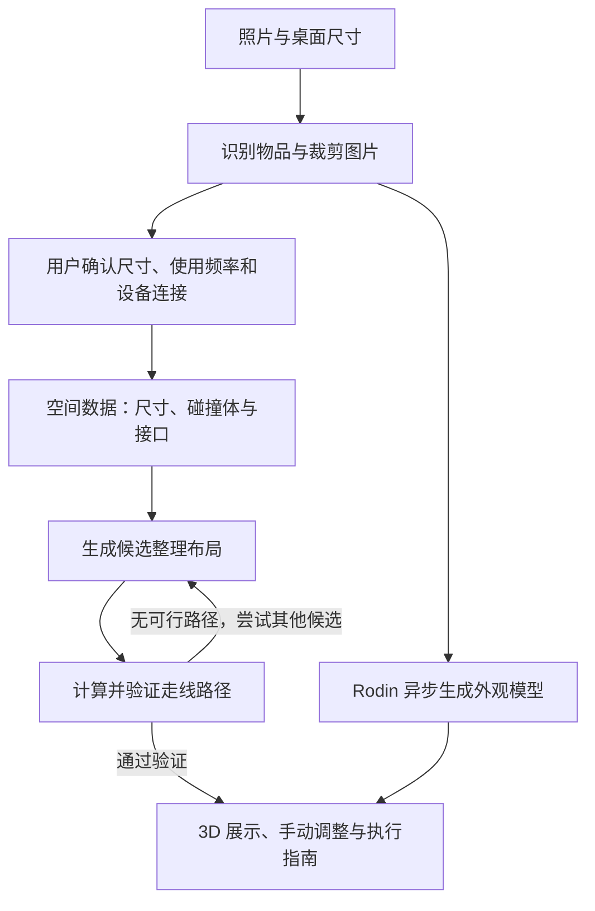

# DormTopology 3D 项目实施方案

> 根据 `idea1.md` 整理。首版目标是完成“照片辅助建模 → 用户校正 → 自动整理 → 自动走线 → 导出执行指南”的完整闭环。
>
> 工期估算前提：3 人小队、有 Web 开发基础，约 5–7 天完成比赛原型。该估算不包含完整商业化、任意场景精确重建或打印配件的充分验证。

## 1. 核心实现原则

**多模态模型负责识别与理解，Rodin 负责生成外观，几何算法负责验证尺寸、摆放和走线。**

首版需要收紧以下预期：

- 单张照片无法可靠恢复真实尺寸、遮挡物体和隐藏接口，因此必须允许用户校正。
- Rodin 采用异步生成流程，需要实测生成耗时，不承诺整桌物品秒级生成。
- 整理结果定义为满足约束的“推荐布局”，不承诺全局最优。
- 生成平滑线缆曲线并不等于完成避障，需要先求解路径，再检查平滑后的碰撞。
- STL 文件可导出不代表配件可以直接使用，尺寸、公差、壁厚和材料仍需验证。

## 2. 首版范围

| 功能 | MVP 实现方式 | 后续扩展 |
| --- | --- | --- |
| 宿舍空间 | 一个可调整桌宽、桌深、书架高度的标准场景 | 多种宿舍模板、空间扫描 |
| 照片识别 | 识别 6–10 件物品，允许补充、删除和修改尺寸 | 更复杂遮挡处理、多视角融合 |
| Rodin 生成 | 优先生成 1–3 个有辨识度的物品，其他使用简化模型 | 更多物品生成、资产复用 |
| 自动整理 | 桌面和书架分区摆放，支持手动调整 | 自由堆叠、更复杂的三维装箱 |
| 自动走线 | 用户确认接口和连接关系，沿桌沿、桌下与立柱规划 | 更复杂线束与动态设备约束 |
| 方案交付 | 整理前后对比、物品摆放清单、走线步骤 | 打印配件、实际执行后的对比 |
| 游戏化 | 自动归位动画 | 刚体交互、装箱游戏 |

建议演示规模：**8 件物品、3 根线、1 个标准桌面场景。**

## 3. 系统架构



候选布局数量应有上限。全部候选失败时，返回具体原因和需要用户调整的条件。

### 推荐技术栈

| 部分 | 建议 | 作用 |
| --- | --- | --- |
| 前端 | React + TypeScript | 操作界面与数据管理 |
| 3D 场景 | Three.js + React Three Fiber + Drei | 场景、模型加载、拖拽和线缆展示 |
| 状态管理 | Zustand | 管理物品、布局、线缆和任务状态 |
| 后端 | FastAPI | 图片处理、模型调用和规划接口 |
| 视觉识别 | 支持图片输入与结构化输出的多模态模型 | 物品识别、类别与使用偏好提取 |
| 3D 生成 | Rodin HTTP API | 单件物品外观生成 |
| 数据存储 | SQLite + 本地文件 | 原型阶段保存场景、任务和模型 |
| 后台任务 | 独立 worker + 数据库任务状态 | 异步生成、失败处理和结果下载 |
| 配件生成，可选 | 参数化 CAD 工具 | 按尺寸生成卡扣与挂钩 |

## 4. 统一数据与空间表示

先定义数据结构，再开发识别、3D 场景和算法，避免各模块使用不同坐标与尺寸约定。

### 4.1 物品数据

每个物品至少包含：

- 唯一 ID、名称和类别。
- 长宽高、位置和朝向。
- 尺寸来源：用户填写、模板或模型估计。
- 使用频率、允许摆放区域和是否固定。
- 是否允许旋转、堆叠，以及必要的操作空间。
- 碰撞体类型与参数。
- 接口在物品局部坐标中的位置、方向与类型。
- 图片地址、生成任务状态和 GLB 模型地址。

### 4.2 两种模型表示

| 表示 | 用途 |
| --- | --- |
| 显示模型 | Rodin 生成的 GLB，用于外观展示 |
| 碰撞模型 | 简化长方体或圆柱体，用于尺寸、摆放与避障计算 |

生成模型未完成时，用户可以直接操作简化模型。资产完成后，仅替换显示模型，并校正原点、朝向与尺寸，保留已有布局。

项目内部统一使用米；界面可以显示厘米。接口的世界坐标由物品位置和旋转计算得到，物品移动后必须同步更新。

### 4.3 线缆数据

每根线缆至少记录：起点接口、终点接口、类型、现有长度、线径、弯曲半径要求、预留余量、规划路径与验证状态。

## 5. 照片识别与用户校正

处理流程：

```text
上传照片
→ 识别物品类别及图片位置
→ 裁剪单件物品，必要时分割背景
→ 展示物品清单
→ 用户确认尺寸、数量和类别
→ 建立场景对象
```

实施要点：

1. 用户填写桌面宽度和深度，并确认关键物品的尺寸。
2. 模型估计的尺寸明确标记为“估计值”。
3. 被遮挡或未识别的物品允许手动补充。
4. 首版允许用户在俯视图上校正原始摆放位置，保证整理前后对比可解释。
5. 常见设备使用接口模板，再由用户调整接口位置。
6. 用户确认“谁连接谁”和现有线长，不能根据设备外观假定隐藏的连接关系。

## 6. Rodin 异步资产流水线

```text
单件图片
→ 提交生成任务
→ 保存任务标识
→ 查询生成状态
→ 下载 GLB
→ 校正原点、朝向和尺寸
→ 替换前端显示模型
```

每件资产具有独立状态：排队、生成中、完成、失败。失败时保留简化模型，允许重试；对同一图片与参数组合做缓存，减少重复提交。

API 密钥放在后端。任务查询要处理限流、超时和失败，不能阻塞场景操作。

官方接入流程使用 `jobs.subscription_key` 查询状态，使用响应顶层 `uuid` 下载结果。应按所选接口的实际响应解析字段，并在所有子任务完成后下载资产。[Rodin 官方接入流程](https://docs.hyper3d.ai/en/get-started/quick-start)

网页演示优先测试较低面数配置。当前官方文档列出的 Fast mode 条件包括：非 `Gen-2.5-Extreme-High` 档位、GLB 格式、Raw 网格、`quality_override <= 20000`。最终参数依据实际账户的耗时、效果和配额确定。[Rodin 生成参数](https://docs.hyper3d.ai/en/api-specification/rodin-gen2-5)

## 7. 整理算法

### 7.1 简化为多个平面上的摆放

将桌面和每层书架分别视为可放置平面。物品使用底部矩形与高度表示，首版只允许少量离散朝向，例如 0° 和 90°。

算法流程：

```text
固定显示器等核心设备
→ 留出键盘、鼠标与操作区域
→ 按尺寸和使用频率排序
→ 枚举候选位置
→ 排除重叠、越界和高度不足的位置
→ 对有效位置评分
→ 局部移动或交换，改善布局
```

### 7.2 约束与评分

硬约束直接排除不可行方案：物品重叠、越界、缺少支撑、层高不足、占用禁止区域。

在可行方案中，根据以下目标评分：

- 保留较大的连续操作空间。
- 高频物品容易拿取。
- 同类物品适当集中。
- 减少不必要的搬动。
- 为接口与后续走线保留空间。

首版采用贪心摆放加局部搜索即可。无处可放的物品进入待处理清单，并说明原因。

自动归位动画可以用位置插值实现。动画用于展示布局变化；实际搬动顺序仍由执行指南说明。

## 8. 走线算法

### 8.1 建立可走线网络

节点包括设备接口、桌沿转角、穿线孔、线槽端点、立柱固定点和排插接口。边表示允许通过的空间区段。

用 A* 或 Dijkstra 寻找路径，考虑：

- 总长度、现有线长与接头及移动余量。
- 转弯次数和弯曲半径。
- 桌面暴露长度。
- 与已有线束共享路线的便利性。
- 水杯活动区、打字区和其他物品碰撞体。

禁止穿越的区域直接从候选路径中排除，不能只赋予较低评分。

### 8.2 平滑与复查

求得路径后，再生成曲线和管状网格。平滑可能使线缆偏离原路径，因此必须复查碰撞、长度和弯曲条件；必要时减少平滑或保留折线路径。

线缆不足或不存在可行路径时，返回明确原因，例如“当前线长不足”“接口附近被遮挡”“需要额外固定点”。

### 8.3 布局与走线协同

先生成有限数量的候选布局，为每个布局计算走线，再选择综合表现较好的方案。用户拖动物品后，重新验证相关线缆；超出原可行区域时，重新规划。

避开水杯区域属于空间规划约束，不能作为电气安全认证。

## 9. Agent 与交付功能

Agent 负责把用户偏好转成规划输入，例如将“我经常看书，希望桌面中间空一点”转成书籍使用频率和操作区域偏好，再调用算法并解释结果。

最终坐标、碰撞验证和路径计算由确定性工具完成。

执行指南根据最终场景数据生成，包含：

1. 物品从原位置移动到目标位置的顺序。
2. 各设备接口与对应线缆。
3. 每根线经过的穿线孔、线槽和固定点。
4. 线长不足、缺少配件和需要用户确认的事项。

可展示的比较指标包括连续可用桌面面积、桌面暴露线缆长度、未解决冲突数。各指标必须使用同一套规则计算整理前后的值。

## 10. 3D 打印扩展

配件先从一个参数化卡扣模板开始，输入桌板厚度、线径与安装方式，再生成尺寸明确的模型。

夹口、公差、壁厚与受力结构由参数化 CAD 控制。Rodin 可以参与外观设计，但不能仅凭生成外观判断配件可以打印并适配。

完成网格检查、切片检查和实际试装后，才能将对应配置标记为已验证；未试装的模型应标记为待验证设计。

## 11. 开发顺序与分工

| 阶段 | 估算时间 | 验收结果 |
| --- | --- | --- |
| 场景与数据结构 | 第 1 天 | 标准桌面、简化物品、拖拽和尺寸编辑可用 |
| 整理算法 | 第 2 天 | 一键整理，无重叠和越界，保留操作区 |
| 走线算法 | 第 3 天 | 接口可编辑，能规划路径并报告线长不足 |
| 图片与 Rodin | 第 4–5 天 | 真实照片触发生成，模型异步替换成功 |
| 联调与路演 | 第 6–7 天 | 整理前后对比、执行指南和失败降级稳定 |

三人分工：

- **成员 A：3D 前端。** 场景、拖拽、尺寸编辑、模型替换、线缆展示与动画。
- **成员 B：识别与生成后端。** 图片处理、多模态识别、Rodin 任务、存储和接口。
- **成员 C：布局与走线算法。** 空间约束、候选布局、路径规划、校验与指标。

第一天共同确定数据结构、单位、坐标系和接口契约，然后并行开发。

## 12. 验收与演示

核心验收项：

- 布局结果满足边界、碰撞、支撑和保留区域约束。
- 物品移动后，接口坐标与相关线缆同步更新。
- 走线路径在平滑后仍满足碰撞与长度限制。
- Rodin 超时或失败时，简化模型与整理功能继续可用。
- 执行指南与最终布局、连接关系一致。

建议演示流程：

```text
上传桌面照片
→ 确认 8 件物品及尺寸
→ 显示简化场景并触发 Rodin 生成
→ 一键整理
→ 确认 3 根线的连接关系
→ 自动规划走线
→ 展示整理前后对比
→ 导出执行指南
```

如使用预先生成的缓存资产进行演示，应明确标注缓存状态，同时保留真实生成任务的展示入口。

**第一个开发任务：用 8 个简化物品和 3 根线，在标准桌面中跑通“一键整理 + 重新走线”。** 完成该闭环后，再接入照片识别与 Rodin 资产生成。
