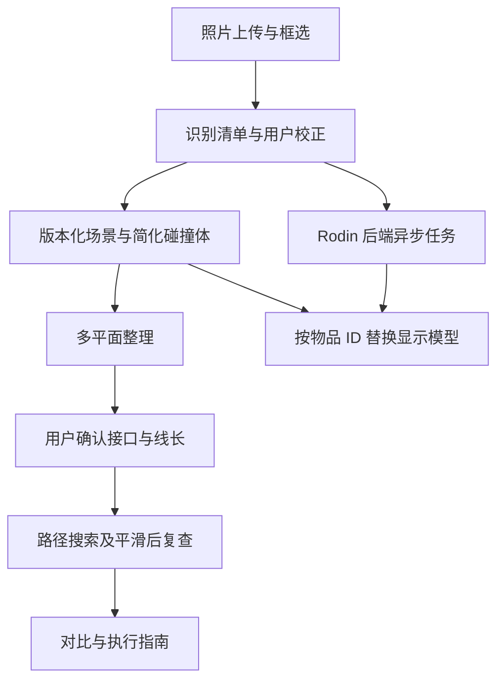

# DormTopology 3D 项目实施方案

本文是首版范围、架构、分工和工期的唯一基线。**硬约束：3 人小队在 48 小时内交付比赛原型。** 数据格式见[数据契约](data_contract.md)，交互见[UX 设计](ux_design.md)，具体完成条件见[任务清单](project_tasks.md)。所有功能当前均待实现。

## 1. 目标与边界

首版闭环：照片辅助建模 → 用户校正 → 推荐整理 → 确认接线 → 自动走线 → 前后对比与执行指南。

多模态模型负责识别与理解，Rodin 负责生成外观，几何算法负责尺寸、摆放和路径验证。首版面向一个经过配置的宿舍桌面，不处理任意场景精确重建。

| 功能 | 48 小时必须交付 | 可选或后续扩展 |
| --- | --- | --- |
| 场景 | 一个标准桌体，桌面和书架支撑面，简化碰撞体 | 多模板、交互式家具结构编辑 |
| 照片识别 | 测试照片的可编辑物品清单、手动补标和尺寸确认 | 多视角、遮挡恢复与分割优化 |
| Rodin | 至少 1 件真实任务完成生成、下载与显示替换；失败时保留简化模型 | 并发生成更多物品、复杂资产管理 |
| 整理 | 8 件物品，多平面贪心摆放，0°/90° 朝向，手动调整与冲突提示 | 自由堆叠、抽屉收纳和局部搜索优化 |
| 走线 | 3 根线，人工确认接口与线长，一个预设 4 位插排，经桌沿/穿线孔/桌下/立柱网络规划 | 背板后策略、4/6/8 位规格选择、线束动画 |
| 交付 | 同视角前后切换、简单归位动画、指标与可导出的执行指南 | 滑动对比、游戏化、AR、打印配件 |
| 终端 | 电脑浏览器完成全部流程，手机可查看场景与结果 | 手机完整编辑流程 |

尺寸默认值是演示配置，来源与解释集中在数据契约。照片中的位置和尺寸由用户校正，不承诺毫米级重建或整桌模型秒级生成。路径结果是满足已建模约束的建议，不作为电气安全认证。

## 2. 系统结构与职责

| 负责人 | 模块边界 | 交付 |
| --- | --- | --- |
| A：3D 前端 | UI、照片补标、简化场景、物品与接口编辑、模型加载、结果展示 | 可操作的电脑端界面和手机查看能力 |
| B：识别与生成后端 | 图片处理、多模态识别、Rodin 适配、任务持久化、场景保存、指南生成 | 识别与生成服务、资产文件、有效版本的指南 |
| C：布局与走线算法 | 空间约束、摆放、路径搜索与校验、连接兼容性和指标 | 整理与走线结果、失败原因 |

A 与 C 共同核对桌体源文件及碰撞几何。Rodin 由 B 统一接入，A 不直接调用供应商接口，C 不等待展示资产。

### 技术选择

- 前端：React + TypeScript、Three.js / React Three Fiber 与 Drei；场景状态集中管理。
- 后端：FastAPI、SQLite 与本地文件；由后端暴露应用接口，并调用 C 的算法函数。
- 异步生成：后端受限后台任务加数据库状态，前端轮询；重启后的未完成任务需按保存的供应商标识恢复查询。首版不引入独立消息队列。
- Rodin：通过 HTTP 适配器接入。B 在前 4 小时实测账户可用的版本与提交、查询、下载流程并记录结果；不把尚未核验的端点或供应商任务字段写作既定契约。

API 密钥保留在后端。模型生成失败、超时或限流时，简化场景、整理与走线继续可用；缓存必须标注来源。

## 3. 空间与资产处理

所有模块使用数据契约规定的米制、右手 Y-up 坐标、底面中心锚点与绕 Y 轴的弧度旋转。接口保存局部坐标，由物品变换计算世界坐标。

显示模型与碰撞模型分离。简化碰撞体和用户确认的尺寸是规划依据；Rodin 完成后仅替换外观，不重置已有位置或重新推测尺寸。统一字段和结果示例只在数据契约中维护。

先用参数化几何开发。现有 `.blend` 与 `.obj` 需检查尺寸、轴向、锚点后导出 GLB，并使桌体网格与支撑面、碰撞体、穿线孔一致。目标路径为 `models/dorm_desk.glb`，当前尚未生成；不依赖含物品的合并场景模型。

## 4. 整理算法

把桌面与各层书架视为独立支撑面，物品用底部矩形与高度表示。先固定核心设备并保留操作区，再按尺寸与使用频率进行贪心摆放，尝试 0° 和 90°。

硬约束：不重叠、不越界、具备支撑、层高足够、不占用保留区、固定物品不移动。评分优先保留连续操作空间，再考虑拿取和搬动成本。不承诺全局最优。

首版只检查一个贪心布局；无处摆放的物品保留原位并返回原因，最终结果必须包含它们参与碰撞检查。若残留物品与推荐位置冲突，回退相应移动，不将有冲突的布局提交为有效方案。多候选联合优化作为后续任务。

归位动画采用位置插值，只表达前后状态；执行指南另行说明真实搬动顺序。

## 5. 走线算法

用户确认设备接口、连接对象、线长、线径和弯曲半径。一个预设 4 位插排提供独立孔位；校验连接类型及孔位占用，不按外观猜测隐藏连接。

在配置好的允许走线网络中，以接口、桌沿、穿线孔、桌下和立柱固定点为节点，用 A* 或 Dijkstra 求路。禁入区和净空不足的边直接排除；总长度必须计入接头与移动余量。

先求路径，再做圆角或样条平滑，最后检查碰撞、线径净空、长度和最小弯曲半径。没有通过复查的曲线不能标记为有效。尝试路径数量必须有上限，失败时说明线长不足、无可行路径或其他具体原因；不能把尖角折线直接当作可执行线缆。

48 小时版只要求经穿线孔的策略。背板后策略仅在核心闭环完成且实际存在可用通道时增加，协议保留扩展枚举不代表首版必须实现。

移动物品、接口、插排或障碍物后，旧路径和指南失效；前端接受结果前校验场景版本。重新规划不自动反复重排布局，失败时请用户调整相关条件。

## 6. 指标与执行指南

原始状态由用户确认后保存为独立快照；当前场景与规划结果使用版本标识。指南由已应用的有效布局、连接关系和路径生成，内容包括物品移动、穿线孔和固定点、线长与未解决事项；变更场景后需重新生成。

比较指标使用同一套规则：桌面连续可用面积、桌面暴露线长、未解决冲突数。面积使用扣除占用和保留区后的固定分辨率网格，取最大四邻接连通分量面积；前后采用相同网格精度并在报告中注明。暴露线长按路径位于 `exposure_zones` 并集内的弧长求和。原始线缆位置尚未录入时，原始暴露线长标记为未知，不推造改进百分比。

不实现独立的多轮 Agent 调度；用户偏好先用结构化选项输入。后续再引入自然语言偏好提取，并由确定性算法验证最终结果。

## 7. 48 小时并行计划

| 时间 | A：前端 | B：后端 | C：算法 | 阶段出口 |
| --- | --- | --- | --- | --- |
| H0–H4 | 场景与界面骨架 | 凭证、真实 Rodin 请求验证 | 简化碰撞与协议样例 | 三方确认数据契约，确认外部服务可用 |
| H4–H16 | 简化场景、物品编辑与模型导入 | 图片识别、裁剪、生成任务与持久化 | 8 件物品整理、硬约束检查 | 不依赖生成资产的一键整理可用 |
| H16–H28 | 框选补标、接口编辑与结果渲染 | 生成查询/下载、失败重试、真实 GLB 交付 | 3 根线的路径搜索与复查 | 至少 1 件真实模型替换，走线可用 |
| H28–H38 | 前后对比、指南展示与导出 | 场景保存、指南生成 | 重算、失败原因和指标 | 真实照片到指南的完整闭环 |
| H38–H44 | 桌面/手机查看检查 | 超时与缓存案例 | 不可行与移动重算案例 | 验收任务与失败降级通过 |
| H44–H48 | 缺陷修复与演示排练 | 缺陷修复与演示记录 | 缺陷修复与结果核对 | 冻结功能，准备路演 |

### 超时处理顺序

1. 优先保留简化几何，暂缓现有 Blender/OBJ 的美术资产导出；不改变物理约定。
2. 只生成 1 件真实 Rodin 资产，其他物品使用简化模型或已标注缓存。
3. 保持单一穿线孔策略与预设 4 位插排，不增加背板策略或规格选择。
4. 使用简单状态切换和位置插值，不增加视觉特效；手机只保证查看。
5. 识别失败时允许手动清单完成演示，同时如实记录识别未达标；服务凭证或配额阻塞真实生成时明确记录，不以缓存替代真实接入验收。

上述降级不能省略几何约束、失败反馈或结果版本检查。核心能力未通过验收时必须报告未完成，不能将缩减演示等同完整交付。

## 8. 后续扩展

首版完成后再安排多候选布局与走线协同、抽屉和堆叠、背板通道、可选插排规格、完整移动端编辑、AR 与打印。

打印配件使用参数化 CAD 控制夹口、公差、壁厚和受力结构；Rodin 仅参与外观探索。STL 是网格模型，经过切片检查和实际试装后才能标为适配，不承诺固定打印时间。
