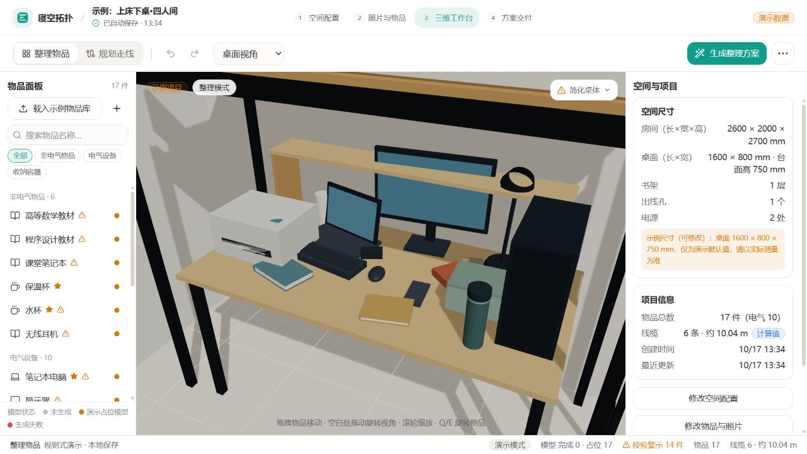

# 扩展整理场景（2026-10-17）

按用户要求，内置示例桌面由 1200 × 600 mm 扩大为 1600 × 800 mm，台面高度仍为 750 mm。尺寸为可编辑示例值，参数化桌体和逻辑边界共用空间配置；未修改 Blender 源资产。

原来的整叠书本拆为高等数学教材、程序设计教材、课堂笔记本，分别拥有 ID、尺寸和位姿，数量均为 1。新增打印机（380 × 200 × 300 mm）、电脑主机（200 × 420 × 380 mm）、电源适配器（100 × 35 × 55 mm）和保温杯（80 × 240 × 80 mm），尺寸顺序为宽 × 高 × 深。原水杯单独保留。

场景共 17 件物品，包含 1 件固定插排。新增设备有独立接口但没有预设连接；仍保留原有 6 条演示线缆。模型为本地简化几何，未接入真实生成资产。旧 `books` 叠放渲染继续兼容已保存项目。

已有浏览器项目不会自动覆盖。通过首页「体验整理演示」或导览「重置并重播」重新载入完整示例；这会重置示例项目。用户自建项目保留现有内容。

本轮完成场景扩展与新形状分类兼容，尚未重设计贪心摆放策略；新增设备可能无法被当前规则安放，结果会继续显示未放置和冲突。17 件扩展前端场景用于后续算法设计，不替代原有 8 件物品的后端契约验收样例。

验证：类型检查、生产构建、现有整理播放回归通过；场景检查确认物品/接口 ID 唯一、三本书独立、旋转后的初始桌面投影不越界。默认偏好下本地规则输出 16/16 件落位、0 未放置、0 对相交、0 越界；浏览器也成功生成 16 步整理操作。该结果仅为当前规则检查，不代表真实搬运与走线验证通过。

