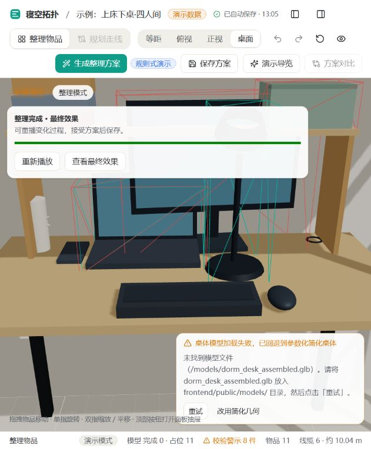

# 整理方案的模型操作演示

后端生成整理方案后，前端将每件物品的结构化目标位置、朝向与文字理由编译为本地模型操作指令。指令通过物品 ID 绑定模型，逐件播放移动与旋转，并高亮当前操作物品。说明文字用于解释动作；当前没有接入将任意自由文本转换为坐标的语言模型服务。

- 自动播放；预览画面内提供暂停、继续、重新播放和查看最终效果。小屏生成后自动收起面板，露出场景。
- 整理面板显示完整指令顺序与理由。查看整理前会暂停；查看整理后直接显示最终效果。
- 重播从本次方案的原始快照开始。预览不会保存物品变换，查看最终效果后才可接受方案，沿用一次撤销记录。
- 未知或重复物品、非有限坐标和移动固定物品的指令会被拒绝；未放置物品保留。场景在等待生成时发生变化，结果不进入预览。
- 系统开启减少动态效果时直接显示最终布局。动画仅展示目标布局，不代表实际搬运过程经过避障或碰撞验证；最终布局仍须由后端独立复查，问题保留在方案中。
- 整理固定请求应用后端，接受时复查并原子应用；网页不再提供规则演示规划模式。运行方式与接口边界见[前后端服务接入](api-integration.md)。

## 历史验证（2026-10-17）

以下保留模型操作演示首次交付时的回归、规则方案和截图，不代表当前后端布局或本轮修改的验收结果。历史回归检查覆盖指令编译、初始快照、暂停与继续、前后对比、重播、不同指令时长下跨帧推进、最终位置、无效引用与坐标、固定物品、最短旋转与减少动态效果。检查命令（仓库根目录，PowerShell）：

```powershell
node frontend/node_modules/esbuild/bin/esbuild frontend/scripts/check-organization-playback.ts --bundle --platform=node --format=cjs --tsconfig=frontend/tsconfig.json --outfile=$env:TEMP/dorm-organization-check.cjs
node $env:TEMP/dorm-organization-check.cjs
npm --prefix frontend run build
```

历史浏览器验证：示例项目生成 9 条操作指令，自动演示、暂停、重播回到第 1 步、查看最终效果均可用；窄屏面板生成后收起。桌体 GLB 缺失时使用简化几何。当时规则方案的目标布局仍有 1 件未放置及 3 对相交，界面保留问题，不作为布局算法全部通过的证据。该轮类型检查与生产构建通过（保留既有大包体积提示）。


