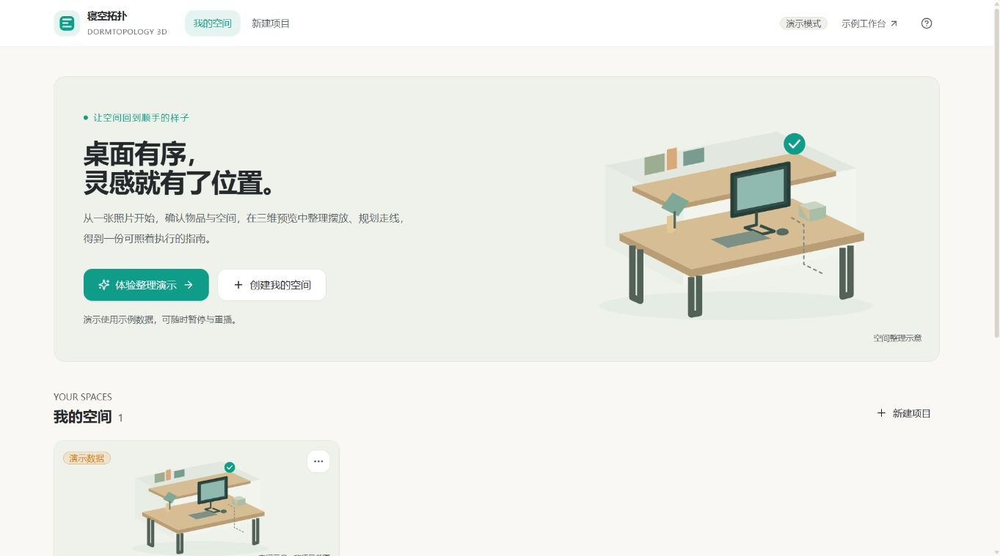
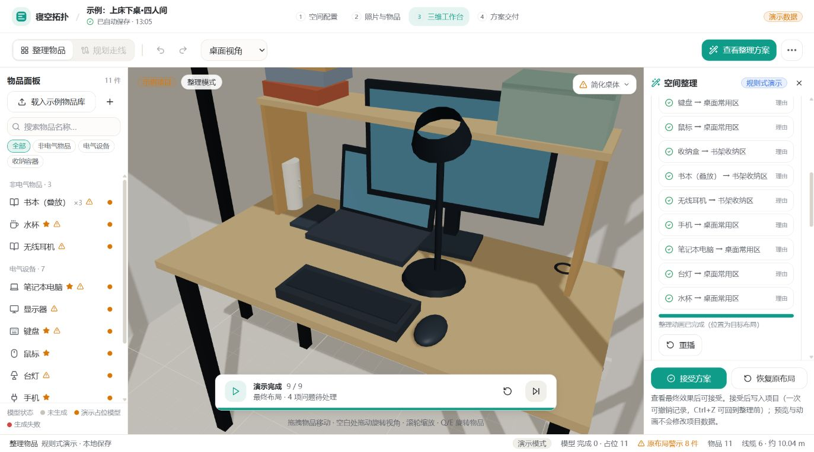
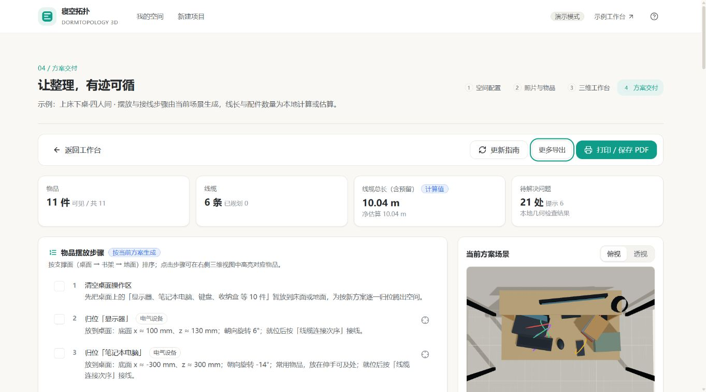

# UI 改版记录 · 2026-10-17

> 2026-10-18 追加：首页按确认的概念稿改为「日间雾白 + 深夜石墨」双主题，最近空间收为底部单行条，其余页面保持本记录描述的浅色外观。改动、截图与未验证项见 [首页改版验收](homepage.md)。

本轮按根目录 [DESIGN.md](../../../DESIGN.md) 实施浅色工作台方向，保留现有 React、Three.js、Tailwind 与本地状态。未新增依赖，未更换服务或算法。

## 已实施

- 首页：空间整理示意插图、演示主入口、项目卡片、四步流程。示意图明确不是项目实拍或重建结果。
- 通用页面：统一标题、步骤导航、按钮、表单、卡片、键盘焦点与触屏主要控件尺寸；新建、空间配置、照片导入和方案指南同步更新。
- 工作台：项目栏与任务栏分开，物品名称留出空间，次要工具进入“更多”，未来未实现的对比按钮不占主工具栏。
- 三维预览：默认视角靠近桌面；俯视隐藏上床展示结构，避免床板遮住物品，碰撞数据不变；分区标签采用固定屏幕字号。
- 整理演示：底部紧凑控制条，暂停、继续、重播、最终效果；最终结果有问题时明确显示数量。侧栏逐件理由按需展开。
- 资产失败：简化模型提示收为小标签，详细原因与重试可展开。
- 指南：打印 / PDF 为主导出，JSON 和截图收进次级菜单；俯视图显示桌面。
- 菜单支持点击外部 / Escape 收起；抽屉加入焦点约束、Escape 关闭与焦点返回。

## 实际验证

- `npm --prefix frontend run typecheck`：通过。
- `npm --prefix frontend run build`：通过；Three.js 大包提示仍存在，不是构建失败。
- 整理指令回归：通过。覆盖快照、播放与暂停、重播、终态一致性、非法引用与固定物品、最短角旋转、减少动态效果，检查脚本见 [播放说明](../organization-playback.md)。
- 桌面浏览器：有效视口 1373 × 764，工作台 `scrollWidth = innerWidth = 1373`，三维 canvas 非空。实际查看首页、新建、空间配置、照片导入、工作台和指南页面。
- 浏览器操作：生成方案后自动播放，暂停停在第 1 步；查看最终效果显示 9/9，接受按钮可用；重播回到第 1 步。预览未接受，原项目布局保留。
- 指南：更多导出可展开；Escape 收起菜单并返回触发焦点；俯视桌面物品可见。
- 浏览器日志：未见 error；有现有 React Router v7 行为预告提示。
- 触屏尺寸、折叠布局和上传焦点有代码级处理，390/768px 与手机真机未实测；不报告为全终端验收通过。打印、PNG/GLB 下载与真实后端未在本轮重复验收。

示例仍有 1 件未放置、3 对相交；界面保留 4 项问题提示，本轮不宣称算法问题已解决。实际桌体 GLB 缺失，截图使用简化模型。

DeepSeek worker 已先分配实现任务，但请求因域名解析失败未生成代码或返回 token 用量，本轮由 Codex 实施与验证。

## 画面证据

