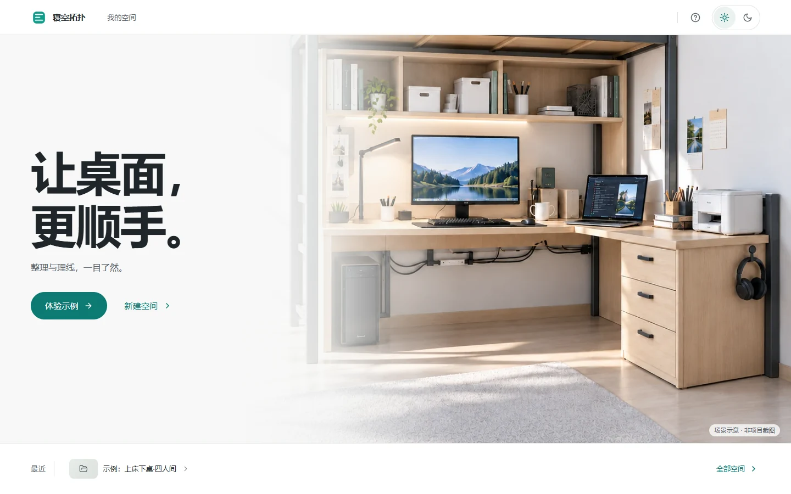
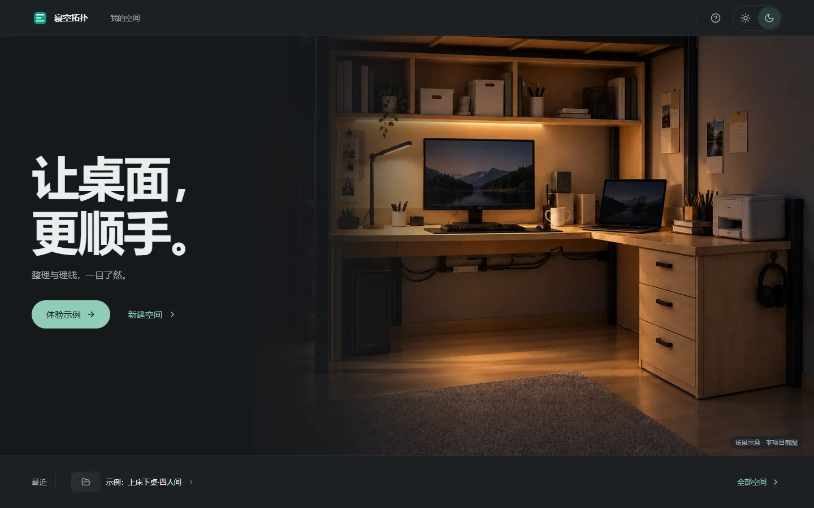
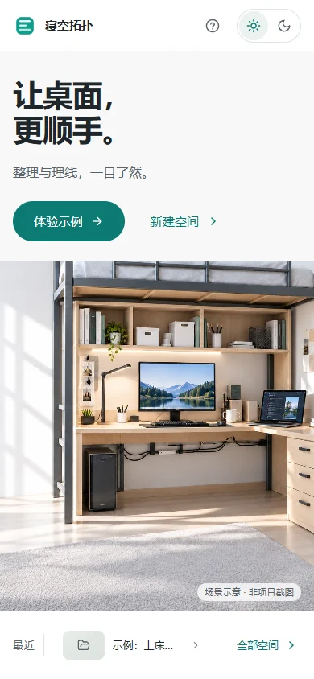
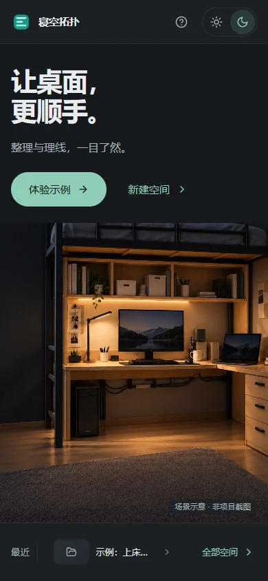
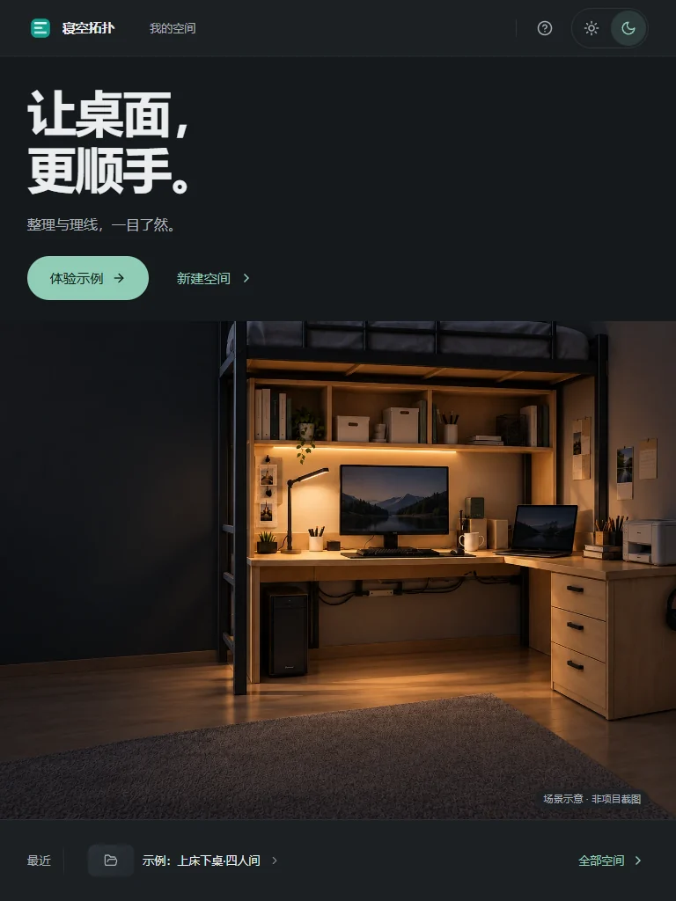
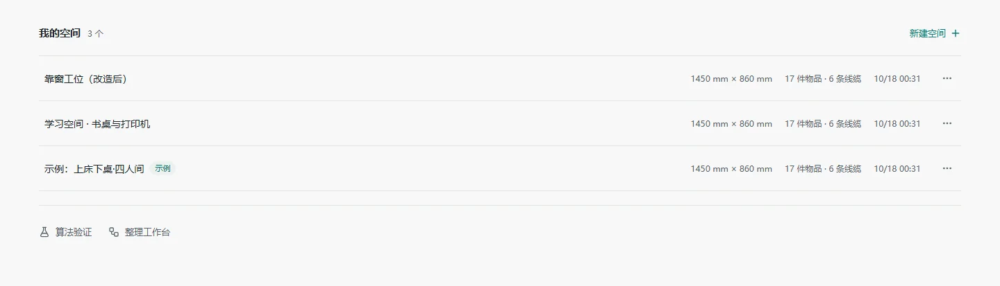
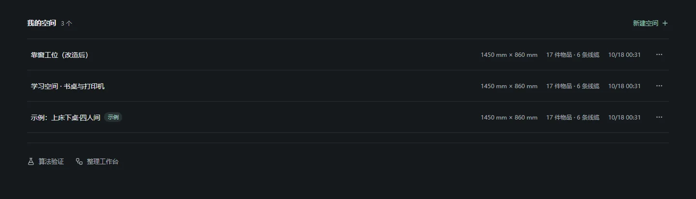

# 首页改版验收 · 日间 / 深夜

记录时间：2026-10-18。范围：仅首页（`/`）。工作台、空间配置、照片导入、方案指南保持原浅色外观。

设计方向与取值以根目录 [DESIGN.md](../../../DESIGN.md) 的「首页视觉系统」为准；上一轮页面改版记录见 [UI 改版记录](README.md)。用户确认的日/夜概念稿在本轮交接目录里（未入库），其中含生成文字，**不是**当前实现截图；方向已固化到 DESIGN.md。

## 改动

| 文件 | 内容 |
| --- | --- |
| `frontend/src/ui/home/home.css` | 重写为 `.home-shell` 作用域令牌；深/浅两套颜色；首屏、最近条、全部空间、焦点与响应式规则 |
| `frontend/src/ui/home/useHomeTheme.ts` | 主题状态重写：订阅/释放对称、重新进入首页重新对齐、存储被禁用时不丢手动选择、不再重复通知 |
| `frontend/src/ui/home/HomeHeader.tsx` | 纯 CSS 控件，去掉与 Tailwind 混用的类；日夜改为一个分段控件；帮助菜单保留算法实验与整理工作台入口 |
| `frontend/src/ui/pages/ProjectsPage.tsx` | 首屏、底部最近单行条、全部空间列表与管理菜单；展开状态只由 URL `spaces=all` 决定；日夜场景图叠放淡入 |
| `frontend/src/ui/layout/AppShell.tsx` | `HomeShell` 在容器上设置 `data-theme`，header 与页面共享同一份令牌；其余路由的壳未改 |
| `frontend/tests/home.spec.ts` | 新增首页 Playwright 验收（见下） |
| `frontend/public/images/home/desk-day.webp`、`desk-night.webp` | 首页场景插图（生成素材，非项目截图） |

## 关键行为

- 文案只保留「让桌面，更顺手。」「整理与理线，一目了然。」与主次操作「体验示例」「新建空间」；其余入口收进「全部空间」与帮助菜单。
- 最近空间为底部单行条：桌面 92px、窄屏 84px，最多两个最近入口，右侧「全部空间」以 `aria-expanded` 展开全部项目。
- 展开列表保留空间配置、照片与物品、查看执行指南与删除；内置示例不可删除，删除需要确认。
- 首页外观：首次跟随系统；手动选择写入 `dormtopology.home-theme`；跨标签页同步；离开首页再返回重新对齐；存储被禁用时退化为内存选择。仅作用首页。
- 场景图为插图，页面固定标注「场景示意 · 非项目截图」；「最近」使用通用项目图标，不冒充缩略图。

## 实际运行的检查

- `npm run typecheck`：通过。
- `npm run build`：通过（仍有既存的 >500kB chunk 提示，不是构建失败）。
- `PLAYWRIGHT_BASE_URL=http://127.0.0.1:5174 npx playwright test tests/home.spec.ts --workers=1`：**28 项通过**（desktop-chromium 1440×1000 与 Pixel 7 各 14 项，用时约 1.5 分钟）。覆盖：真实插图加载与可见性、无横向溢出、日夜跟随系统/手动持久化/忽略系统变化、存储被禁用不崩溃且保留选择、写入失败后由其他标签页写入可恢复、跨标签页同步、离开再返回重新对齐、最近条高度 ≤110px 与两个入口、全部空间行数与直达 `/?spaces=all#all-spaces`、项目管理菜单与示例保护、删除确认取消/确认只删临时项目、新建入口、帮助面板 Escape 关闭并回焦、帮助面板在 390/320 宽度不出屏、键盘焦点顺序。
- 浏览器截图（真实渲染，非概念稿）：1440×900、1366×768、768×1024、390×844 各日/夜两版，逐张检查构图、标题层级、最近条高度、无横向滚动；据此修正了窄屏场景图不撑满、切换日夜时插图空白帧、品牌标记双层底色三处问题。
- 首页「体验示例」真实点击：进入 `/projects/demo-dorm-101/workspace`，canvas 为 WebGL 且非空、`pageerror` 为空；本轮未改动工作台，未重跑 17 件整理回归。
- 对比度按 WCAG 公式本地计算：正文 5.76:1（日）/ 7.84:1（夜），主操作文字 5.2:1（日）/ 9.3:1（夜）。

## 证据画面

日间 1440×900：

深夜 1440×900：

窄屏：日间 390×844、深夜 390×844、平板深夜 768×1024。

全部空间（日 / 夜，含两个临时测试项目）：

1366×768 日间：[home-day-1366.webp](home-day-1366.webp)。

## 未验证 / 边界

- 只有 Chromium（含 Playwright 自带 1440×1000 与 Pixel 7 模拟）；Firefox、WebKit 与真机未跑。`color-mix()` 与 `svh` 都已写好兜底，但兜底分支没有在旧内核里实测。
- 首页保存的是临时夹具项目，不涉及真实识别或 Rodin 生成；插图与项目 GLB 家具并不完全一致，页面已标注为示意。
- 深夜模式当前只覆盖首页；工作台与其余页面仍是浅色，是否扩展到整站仍需用户决定。
- 本轮没有向 DeepSeek worker 提交实现或测试任务；`.work/home-refresh` 里已有的回执保持原状。其中 `tests-run` 的完整对象已恢复后逐行审查，其移动端断言（窄屏下表头“我的空间”是 `display:none`）与伪跨标签页步骤不成立，测试按实际行为重写。之后提交过一次只读评审任务，结论见下。

## 评审任务与采纳情况

任务 `review-run`（首次调用因 `.css` 不在 worker 支持的文件类型内报错）与 `review-run-2`（把样式表复制成 `.work/home-refresh/home-css.txt` 后重发）。第二次请求返回的 JSON 被截断（`Unterminated string ... char 9955`），回执状态保持失败，用量未知，未回填成功。可读部分给出 3 条完整结论与 1 条部分结论，逐条在本地复核后处理：

| 结论 | 复核结果 | 处理 |
| --- | --- | --- |
| `100svh` 没有 `100vh` 兜底，旧内核会整条丢弃 `min-height` | 成立 | 加 `min-height: 100vh` 兜底，`100svh` 覆盖 |
| `.home-hero::before` 的 `color-mix()` 是该渐变的唯一中间色标，不支持时整条 `background` 失效，遮罩消失 | 成立（无效声明会被整条丢弃） | 先写纯色渐变兜底，再写 `color-mix` 版本 |
| `.home-scene-label` 的 `color-mix` 背景同理，失配时文字直接压在插图上 | 成立 | 同上，先 `var(--home-surface)` 再叠 `color-mix` |
| `color-mix` / 帮助面板定位相关的一条被截断 | 自行复现了帮助面板问题：390/360/320 宽度下左边缘分别为 −12 / −42 / −74px，右侧锚定的绝对定位面板会跑出屏幕 | 720px 以下改为 `position: fixed` 的贴边面板，并加 390/320 宽度断言 |
| 存储写入失败后 `sync()` 永久短路，无法再采纳其他标签页的选择 | 成立 | 简化 `sync()`：读到明确值即采纳并解除锁定，仅在「读得到但没有值且本会话写入失败」时保留内存选择；新增恢复用例 |

其余被判定为“健全”的部分（订阅/释放对称、`data-theme` 单一来源、最近条高度、焦点顺序）与本地检查一致。
