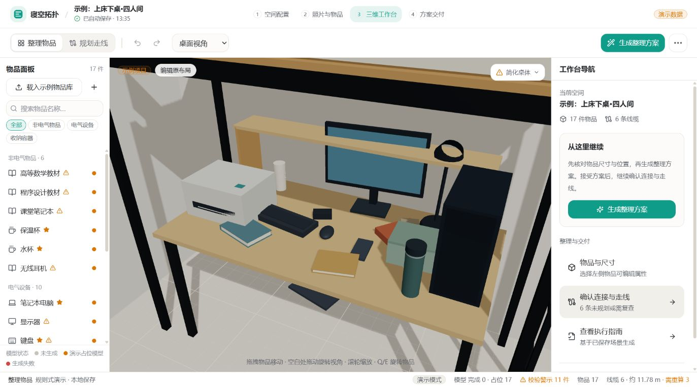

# 工作台流程优化（2026-10-17）

前一轮 UI 与整理演示已提交并推送为 `0466408`，分支 `codex/adjust-organization-algorithm`。本轮继续改善工作台流程，新增改动尚未提交或推送；另一轮示例场景扩展保持原有工作区内容。

## 交互变化

- 无选中物品时，右栏显示工作台导航：确认物品、生成整理、确认连接与走线、查看已保存场景的指南。
- 将整理会话与面板可见性分离。收起面板保留暂停进度；继续查看不会重新显示分区或重置播放。空的偏好配置面板关闭后直接返回编辑。
- 显式取消预览才丢弃临时结果。生成中也可取消；后台返回的已取消结果不会重新进入预览，任务按已取消记录。
- 同视角“整理前 / 最终方案”可直接在画面内切换。查看原布局时明确提示原始快照，只有正在查看最终方案时才能接受。
- 生成与预览期间保护原布局：禁用撤销重做、增删和隐藏/锁定物品、修改偏好及保存候选方案；拖拽沿用同一保护条件。相机与物品选择仍可操作。
- 生成任务使用会话令牌隔离。关闭会话、离开工作台或切换项目后，旧结果不会覆盖新会话。
- 接受前核对项目、空间、物品、连接与偏好的来源指纹。来源变化时拒绝应用旧方案，要求取消后重新生成。
- 无需移动的方案不提供无意义的接受操作。布局可行性与走线状态仍按实际结果显示，没有新增算法成功承诺。

## 验证

- 类型检查、生产构建通过；保留既有 Three.js 大包提示。
- `check-organization-playback.ts` 原回归通过；新增检查覆盖面板收起/重开、进度保留、来源变化、会话令牌失效、生成保护和空配置关闭。
- 桌面浏览器实际验证：生成后暂停在第 1/16 步；收起面板显示“整理预览已保留”；重新打开仍为原进度且分区保持关闭；查看整理前时接受按钮禁用；取消生成后回到编辑界面。
- 浏览器验证使用工作区现有的扩展场景，没有将该扩展混入 `0466408`。未接受测试方案，原项目布局保留。
- 手机真机、真实后端和真实模型加载没有在本轮补验；这轮是本地 UI 与会话行为改进。

