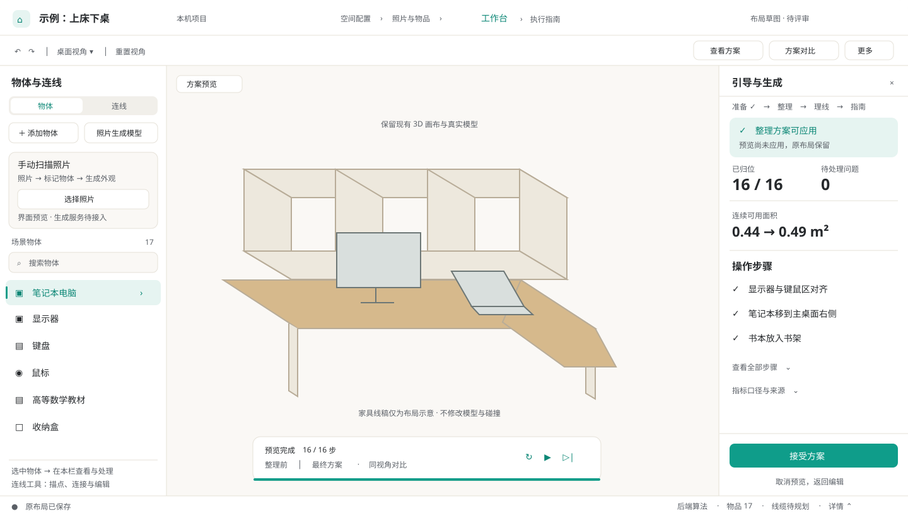

# 工作台 UI 优化提案

状态：已按用户确认分工实施，验收记录见 [implementation.md](implementation.md)。日期：2026-10-17。范围：`/projects/:id/workspace`。以下保留设计依据与方案，完成情况以实施记录为准。

视觉决策沿用根目录 [DESIGN.md](../../../DESIGN.md)，功能与流程沿用 [UX](../../../docs/ux_design.md) 和 [工作台会话说明](../workspace-flow.md)。用户本轮明确的“左侧物体处理、右侧引导生成”覆盖旧文档中对象属性挂在右侧的布局约定；全站主题与数据契约保持现有来源。

## 结论

按用户最新意见，采用“左侧准备和处理输入，中央操作场景，右侧引导和生成结果”的工作台。保留暖白、石墨文字和青绿主色，不更换编辑器或组件库。

职责明确区分：**照片生成单件模型属于左侧物体处理；生成整理方案、生成理线方案属于右侧任务操作。** 右侧不再因选中物体而跳到对象属性页。用户选中物体后的属性、尺寸和处理工具归入左侧，由既有编辑组件复用，不复制字段与业务逻辑。

## 评估依据与限制

已阅读当前 `29b2009` 的工作台页面、工具栏、列表、导航、属性、整理面板、预览条、状态条及全局主题。结合本会话此前真实服务验收的桌面与模拟手机截图评估；截图对应此轮开始前的界面，不宣称本轮重新完成了在线验收。浏览器本次读取未成功，新画面复验留到实施阶段。

| 优先级 | 直接证据 | 设计判断 |
| --- | --- | --- |
| P0 | `Toolbar.tsx:136` 与 `WorkspaceOverview.tsx:37` 同时提供强调色“生成整理方案”入口，实际都打开偏好面板 | 主入口重复，按钮名称也容易让人以为已开始生成 |
| P0 | `StatusBar.tsx:50` 起混合模式、长提示、服务、任务、模型、物品、线长与问题，允许整体换行 | 常驻状态负担过重；手机纵向空间受到明显挤压 |
| P0 | `OrganizePanel.tsx:608` 起同时堆叠算法摘要、指标、动画、规则、示例与未放置清单 | 结果是否能应用应先于解释；关键指标与接受动作应稳定可见 |
| P1 | `WorkspacePage.tsx:472`、`:537` 为 216px 左栏和 288px 右栏，1440px 下画布约占 65% | 基础比例可保留，不宜为了“高级感”再扩大两侧栏 |
| P1 | `Toolbar.tsx:103` 为 56px 项目栏，`:120` 工具栏可换行；截图中手机还有多行状态区 | 移动端更需要收纳和固定节奏，不能靠缩小字号挤进去 |
| P1 | `LeftPanel.tsx` 同时表达外观状态、常用、固定、锁定及校验警示 | 需要区分“使用简化外观”和“摆放有问题”，避免黄色状态被误读 |
| P1 | 已验收截图中桌面视角较近，前柱遮挡部分右侧物品 | 相机取景值得后续复核；属于视觉判断，不推断几何或碰撞错误 |

## 推荐布局

草图仅表达信息层级和布局，不代表已实现。中心家具为示意线稿，不是替换现有模型的方案。指标采用此前已验收的 17 件示例，具体展示仍以实际结果为准。

### 顶部：项目导航与任务工具分层

- 第一行保留项目名、流程位置和返回入口；减少重复的示例、服务与保存标签。
- 第二行保留撤销重做、视角、方案对比与次要菜单。物体/连线工具选择放到左侧，并映射现有工作台模式，不额外维护一套互相独立的模式状态。
- 方案生成与接受集中在右侧。窄屏顶部可保留“任务与方案”入口，仅打开右侧抽屉；不成为第二个直接生成或应用入口。
- 不把“接受方案”直接接到新的工具栏处理函数；保留现有确认、校验、版本核对及原子应用链路。

### 左侧：物体添加与处理

- 宽屏建议约 264px，以容纳物体处理和照片入口；列表与对象详情采用同栏切换，不把全部表单同时铺开。
- 顶部提供“添加物体”“照片生成模型”。照片入口先做前端样式与本地预览：选取照片 → 标记/裁剪示意 → 名称与尺寸区域 → 生成按钮占位。明确标注“界面预览，生成服务待接入”，不得提交生成请求、伪造进度或生成成功。
- 物品清单保留搜索、筛选、选中、显隐、锁定、重命名、删除等已有能力。选择物体后，左侧切到该物体处理视图，提供返回清单；不抢占右侧引导。
- 物品名称 13–14px，辅助状态至少 12px；选中行使用淡青底和清晰边缘。
- 简化外观用中性标签；碰撞/越界保留警示图形和可读说明。固定、锁定、常用继续显示原有语义。
- 显隐和锁定按钮在悬停、键盘聚焦及对应状态下可见；触屏不能依赖悬停。
- “连线”工具区承接用户描点建立连接、查看连接和编辑已有线缆的入口。描点、端点、线缆数据及交互由负责该功能的 agent 交付；本任务只预留展示容器，不另写一套实现。
- 不新增碰撞箱字段或确认规则。尺寸、接口及模型的既有编辑组件待相关 agent 字段稳定后迁移挂载到左侧，不同时修改其实现。

### 右侧：固定的引导、生成与结果面板

- 默认按“准备物体 → 整理布局 → 确认连接与理线 → 查看指南”给出当前步骤和下一步。选中、拖动物体或切换左侧处理视图，不会把右侧替换为对象属性。
- 整理阶段容纳尺寸/原始位置确认、整理偏好、生成整理方案、预览、前后对比与接受。理线阶段容纳连接确认、生成/更新理线、校验结果和后续指南；调用既有能力，不改变负责 agent 的接口和逻辑。
- 整理结果先显示“可应用 / 仍有问题”，再显示归位数、连续可用面积与问题数，最后显示操作步骤与说明。
- 使用中性结果卡和对齐的数值，不重复套多层带边框卡片；不要把指标口径、规则和调试信息全部默认展开。
- 接受/取消区域继续固定于面板底部；不可行、过期、正在应用、无需变更的禁用语义保持一致，原因仍可见。
- 整理/理线生成使用本区域的主要按钮。局部“照片生成模型”仍属于左侧，且本轮只是样式占位，不能与真实算法任务混淆。

### 画布与播放：轻量覆盖

- 优先保留现有可操作面积；角落只留必要的编辑/预览状态，不新增满屏浮动卡片。
- 播放条显示当前动作、暂停/继续、最终效果和前后切换；详细原因保留在侧栏。
- 播放条、场景提示、通知和手机安全区需要统一避让。不得改变预览推进、收起保留、取消丢弃等行为。
- 取景优化独立放在第二阶段：核对桌面、书架与回台能否看全；仅讨论相机，不调整资产尺寸、变换和碰撞。

### 底部：状态摘要

- 桌面目标为单行约 32px：保存状态、当前任务/失败摘要、物品与问题入口。
- 模型明细、服务诊断和历史任务收入可展开详情；失败与未解决问题不能仅靠悬停才能发现。
- 长反馈使用不遮挡操作的短通知，并可在任务详情回看；不让长句持续撑高整条状态栏。
- 演示、缓存、真实请求和未知指标仍明确标注，不能因美化而隐藏事实。

## 视觉规格

- 沿用现有语义色：`background`、`surface`、`border`、`foreground`、`primary`、`warning`、`danger`；不硬编码另一套品牌配色。
- 面板标题 14–16px、主要内容 13–14px、说明 12px；11px 只用于非关键元信息，数值等宽。
- 间距使用 4/8/12/16/24px；控件圆角 8px、面板/浮层 12px；只给真正的浮层明显阴影。
- 同屏只有当前步骤的主要动作使用实心青绿；对比、帮助、保存候选等采用次级样式。
- 不新增字体、图标库、动画库；不修改真实模型的材质、灯光或色彩以迎合 UI。

## 响应式

| 宽度 | 行为 |
| --- | --- |
| ≥1440px | 双栏建议左 264px / 右 288px；画布约 62%，两侧各自滚动 |
| 1280–1439px | 优先检查 1366×768；处理表单不挤压画布，不足时将非当前侧收为抽屉 |
| 1024–1279px | 沿用左栏、右侧抽屉，不新增另一套面板状态 |
| 768–1023px | 保留现有抽屉机制，一次主要使用一个任务面板 |
| <768px | 物体/连线工具与任务/方案分别由左右抽屉承载，避免叠开；照片入口可本地预览，生成能力仍明确未接入，不扩充完整手机编辑 |

不将新底部导航或可拖动侧栏列入第一阶段，这些会扩大状态与交互改动。

## 协作边界与冲突控制

| 归属 | 路径/区域 | 本任务策略 |
| --- | --- | --- |
| 本任务第一阶段 | `ui/workspace/Toolbar.tsx`、`LeftPanel.tsx`、`WorkspaceOverview.tsx`、`StatusBar.tsx`、`OrganizePanel.tsx` 展示部分；新增照片生成样式组件与左右侧容器草案 | 只调整布局、文案层级和外观；照片生成不接服务，描点区只留接入口 |
| 模型/碰撞 agent 优先 | `RightPanel.tsx` 的尺寸/接口/模型部分，模型导入、生成、包围盒、碰撞及 scene 几何模块 | 第一阶段整文件避让 `RightPanel.tsx`，不变更字段、确认流程和几何 |
| 理线/描点 agent 优先 | `backend/`、`api/`、理线领域与状态，以及 `CablePanel.tsx`、`CableListPanel.tsx` 和描点交互 | 第一阶段不改；待其交付后将工具挂入左侧、任务结果挂入右侧，不重复实现 |
| 主页 agent 优先 | 首页、`AppShell.tsx`、全局 CSS、Tailwind 配置、`ui/kit/`、公共导航、品牌组件、根 `DESIGN.md` | 使用现有语义令牌，不统一改公共组件；不编辑其文件 |
| 共享高风险文件 | `WorkspacePage.tsx`、`Viewport.tsx`、`CameraRig.tsx`、公共浏览器测试与全局文档 | 第一阶段只读；需要修改时先确定唯一写入方，独立小提交，待相关 agent 的改动落定再集成 |

具体到 Git：不在共享目录执行切分支或合并。实施使用基于 `29b2009` 的独立工作树与 `codex/workspace-ui-polish` 分支；逐文件暂存，不包含其他 agent 的 README、交付资产或锁文件。集成时逐提交检查，不整目录覆盖，不对同一 TSX 文件批量格式化。

独立分支只能隔离工作区，不能保证没有语义冲突。若另一个 agent 正在修改本任务首选文件，同样先由其完成对应逻辑，再由本任务补展示；不以“只改样式”为由同时重写同一组件。

## 分阶段验收

1. **第一阶段：独立展示组件。** 工具栏、左侧物体工具与照片生成样式、右侧引导/方案、状态条。复用既有状态，不调整 API、物理几何和三维控制；共享页面尚未挂载的新样式不宣称已可用。
2. **第二阶段：单一写入方集成。** 待描点/理线与模型任务稳定后，由唯一写入方调整 `WorkspacePage.tsx`：对象编辑挂左侧、任务引导固定右侧，接入现成描点工具。再处理画布浮层避让与必要的相机构图。本任务不提前覆盖该共享文件。
3. **验收。** 1366×768、1440×900、768×1024、390×844 截图检查；覆盖默认、选中、生成中、有效预览、不可行、过期及服务失败状态。只使用真实结果或明确标注的测试状态，不伪造成功。

验收门槛：无横向溢出和按钮遮挡；手机关键触控目标不小于 44px；文字与状态对比度经检查；键盘焦点与 Escape 行为保留；减少动态效果可用。选中物体时右侧引导与预览会话不丢失；照片样式演示不发送生成请求或伪造结果。桌面完整流程、手机查看、真实 17 件整理应用与场景回读应继续通过。保留失败拒绝、原始布局、模型/碰撞与接口数据；不把截图检查计为算法或真机验收。

本次共享页面仅修改组件挂载及小屏抽屉去向，保留请求编排；属性组件实现未改。理线面板仅新增默认兼容的展示开关，具体范围见实施记录。相机、场景资产和全局主题不在本次改动中。
