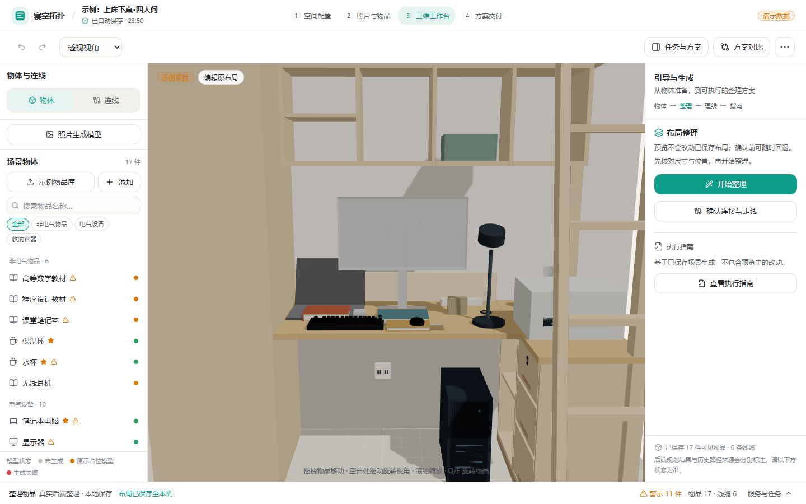

# 工作台左右职责与 UI 实施

用户确认：左侧负责物体添加/处理、照片生成模型样式及描点连线入口；右侧负责引导、生成方案、预览与接受。基于 `29b2009`，独立分支 `codex/workspace-ui-polish`，独立工作树位于仓库忽略的 `.work/workspace-ui-polish/checkout/`。

## 已实施

- 新增 `WorkspaceToolPanel`：左侧物体/连线工具使用既有工作台模式；对象属性、线缆属性复用现有组件，选中后在左侧显示并可返回清单。右侧不会因选择物体而切为属性面板。小屏选择场景物体时打开左抽屉，左右抽屉互斥。
- 新增 `PhotoModelDraft`：选择 JPEG/PNG/WebP（不超过 10MB）、本地图片预览、名称输入、清除和重选。对象 URL 在替换/卸载时释放；非法格式显示错误。生成按钮明确为“待接入”并禁用，没有网络调用、物品创建、伪造进度或生成结果。框选仅作后续说明，没有伪装成已可用的标注器。
- 新增 `WorkspaceGuide`：右侧保持任务引导；整理入口、连接确认、理线规划/更新与执行指南集中于右侧。仍使用现有确认、真实服务回调与校验，不新增 API 或算法。
- `Toolbar` 收敛为编辑与视角工具、次级“任务与方案”和方案对比；物体/连线切换移至左侧。`StatusBar` 保留单行摘要与可见警示，把模型/服务/任务明细和失败重试收入可展开详情。
- 物体列表选中和添加入口更清楚；新增工具切换及触屏列表行保留 44px 目标。整理面板折叠分区说明，结果指标更突出，接受和取消保留原固定区域。

## 与其他 agent 的边界

没有修改主页、`AppShell`、全局 CSS、Tailwind、公共 UI kit、API、后端、碰撞/模型模块、`CameraRig`、`SceneObjectMesh` 或对象属性实现 `RightPanel.tsx`。共享工作区中新出现的物体缩放、相机及交付文件未复制进本分支。

需要集成时检查以下三个交叉点，采用小提交合并而非覆盖文件：

| 文件 | 本次变化 | 合并建议 |
| --- | --- | --- |
| `WorkspacePage.tsx` | 引入左工具/右引导，移除旧左右组件切换，抽屉互斥 | 保留其他 agent 新的处理函数；只合并组件挂载。已逐段对照原模型生成和理线请求函数，内容相同 |
| `CableListPanel.tsx` | 可选 `showPlanningActions`，默认 `true`；本工作台左侧传 `false` | 保留描点、设备接口及默认补充接口逻辑；开关只控制确认/规划/更新按钮 |
| `CablePanel.tsx` | 同名可选开关，默认 `true` | 只隐藏两个重新规划按钮，保留警示、端点和路径编辑；规划集中右侧 |

独立分支隔离了工作区，但不能保证后续合并无语义冲突。最终将其他 agent 新描点 UI 挂载左侧时，以其交付为准；本任务没有另写描点实现。

## 实际验证

- TypeScript 与生产构建通过（既有 Three.js 主包体积提示仍在）。领域算法和数据契约未修改，不重复声称运行此前的后端全量测试。
- `workspace-ui-polish.spec.ts` 最终一次 **8/8** 通过（桌面及模拟 Pixel 7 各 4 项，约 1.7 分钟）。覆盖本地照片无 API 写入、非法格式/清除、左侧属性与右侧引导分离、连接确认和理线按钮只在右侧，以及 1440×900、1366×768、768×1024、390×844 的画布可见与无横向溢出。
- 初轮照片检查将 `*.generated.ts` 静态资源误识别为生成请求；修改请求过滤为实际 API 写入后，桌面/手机照片专项 2/2 通过，再执行上述完整 8/8。初轮结果不作为最终通过。
- 真实服务原有 6 项检查本次首轮 3/6 通过：桌面普通整理应用及版本冲突、手机版本冲突通过。桌面与手机 17 件用例超过 90 秒等待窗口，另一次手机普通流程超过 30 秒；原测试及其时间阈值保持不变。桌面 17 件任务在后端约 186 秒后返回 `success`、零布局问题，但测试已超时，未计为浏览器完整应用通过。
- 为区分功能与等待窗口，在本地临时副本中保留全部原断言，仅将 17 件用例等待预算扩至 300 秒、总时限 330 秒，普通流程总时限 150 秒，串行复验最终 **6/6** 通过（约 5.4 分钟）。覆盖桌面及模拟手机的 17 件全部归位、零问题、原子应用与持久化回读，模型/尺寸保留、固定物品不动及过期结果拒绝。17 件完整浏览器操作各约 2.1 分钟，不能据此宣称原来的 90 秒门槛已通过。临时文件不提交；正式测试没有放宽或删改断言。

截图为实际界面；手机为浏览器模拟，不是实机验收：



[手机画面](workspace-mobile.png)

[17 件方案应用后的桌面画面](workspace-applied-desktop.png) · [模拟手机画面](workspace-applied-mobile.png)

## 复验与预览

独立前端：`http://127.0.0.1:5187/projects/demo-dorm-101/workspace`，通过 `VITE_DEV_API_TARGET` 连接原本的 `8001` 整合服务，未占用其他 agent 的预览端口。执行检查前确认服务地址与对应代码版本。

在 `frontend/` 执行：

```powershell
npm run build
$env:PLAYWRIGHT_BASE_URL='http://127.0.0.1:5187'
$env:PLAYWRIGHT_BROWSERS_PATH='C:/Users/jdz/AppData/Local/ms-playwright'
node node_modules/@playwright/test/cli.js test tests/workspace-ui-polish.spec.ts --workers=1
```

## 委派与剩余限制

按项目约定先向配置的 `deepseek-pro` 委派组件、接入补丁和测试草案，Codex 审查修正并实际执行检查。3 次完成且有用量的请求合计 **55,162 tokens**；另 4 次响应格式、范围或解析失败，用量未知，回执保持失败状态，未据此声明已执行测试。仅采纳审查过的完整内容。原任务、回执、日志在主工作区忽略目录 `.work/workspace-ui-polish/`。

照片生成和框选尚未接后端；新描点能力由对应 agent 接入。相机取景、本体碰撞箱、理线算法、主页和全站主题未纳入这次 UI 改动。原有 17 件真实规划等待时间是明确的待复核性能问题，不将增加临时等待预算视为性能修复。
